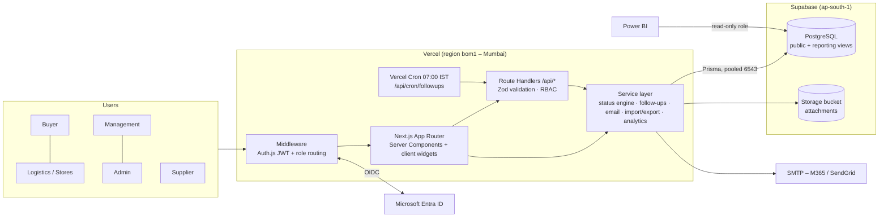
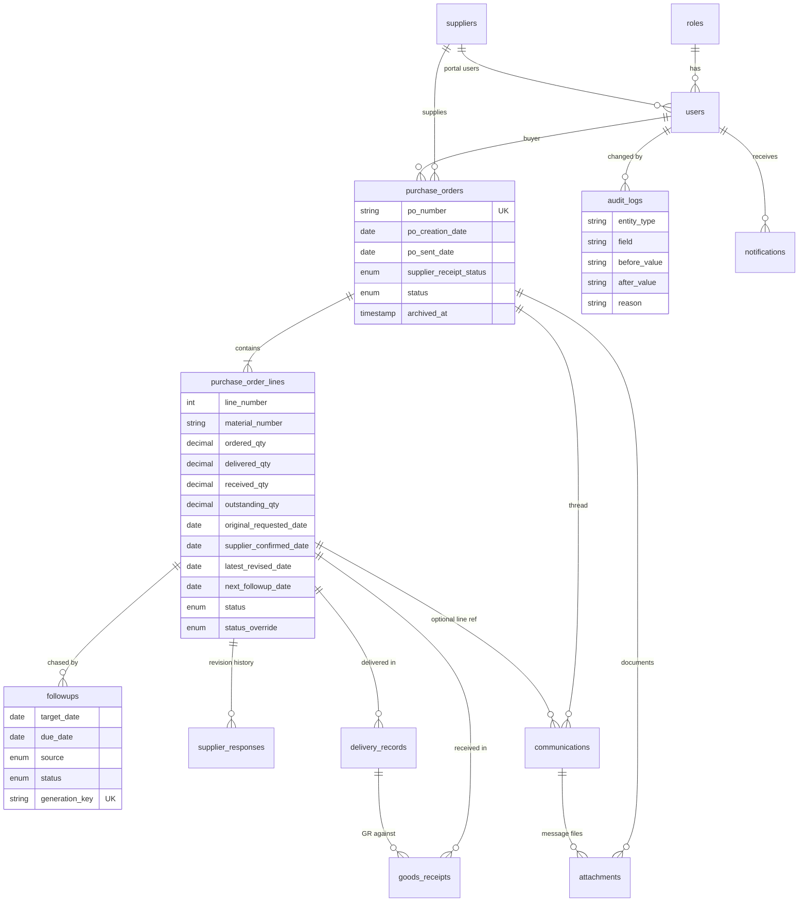
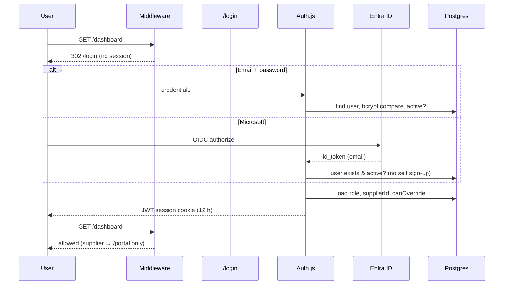

# SupplySync – Architecture & Technical Reference

Sections follow the requested deliverable order. Code references point into `src/`.

---

## 1. Solution architecture



**Layers**

| Layer | Responsibility | Where |
|---|---|---|
| Middleware | Session check, supplier ↔ internal area separation | `middleware.ts`, `auth.config.ts` |
| Pages (Server Components) | Read data directly through services, render HTML | `app/(app)/**`, `app/portal/**` |
| Client components | Dialogs, forms, charts, wizards; call REST API then `router.refresh()` | `components/**` |
| Route handlers | Authn/authz, Zod parsing, call services, JSON errors | `app/api/**`, `lib/api.ts` |
| Services | All business rules, transactions, audit | `services/**` |
| Data | Prisma schema, SQL views | `prisma/**` |

Every mutation runs in a Prisma transaction that (1) changes data, (2) writes audit rows, (3) recalculates the line status and PO header, (4) re-syncs follow-ups. That keeps status, follow-ups and audit consistent no matter which screen or API made the change.

## 2. Database ERD



`settings` is a standalone key/value table (follow-up lead days, GR pending days, risk threshold…).

### Relationship notes

- **PO header vs line.** Supplier, buyer, sent/acknowledgement dates live on the header (`purchase_orders`); quantities, dates, follow-ups and status live on the line (like SAP EKKO/EKPO). The tracker shows one row per line.
- **Quantities are derived.** `delivered_qty` = Σ delivery_records, `received_qty` = Σ non-reversed goods_receipts, `outstanding_qty` = ordered − received. They are stored for fast filtering but always recomputed by `recalcLine()`.
- **Follow-ups** reference the supplier date they were computed from (`target_date`). `generation_key = lineId:yyyy-mm-dd` is unique, so one AUTO follow-up per supplier date – guaranteed by the database.
- **Supplier responses** are append-only and keep `previous_date` → `revised_date`, forming the revision history.
- **Communications** cover comments, emails (with SMTP status) and system events. `internal = true` hides a note from suppliers.
- **Nothing is hard-deleted**: `archived_at` on POs, `reversed` on GRs, `active` on users/suppliers, `SUPERSEDED`/`CANCELLED` on follow-ups.

### Indexes

Declared in `schema.prisma`: unique `po_number`; unique `(purchase_order_id, line_number)`; `purchase_orders(supplier_id)`, `(buyer_id)`, `(status, archived_at)`, `(po_creation_date)`; `purchase_order_lines(status)`, `(supplier_confirmed_date)`, `(latest_revised_date)`, `(material_number)`, `(plant)`; `followups(status, due_date)`, `(line_id)`, `(assigned_to_id, status)`; `communications(purchase_order_id, created_at)`; `audit_logs(entity_type, entity_id)`, `(po_number)`, `(created_at)`; `notifications(user_id, read, created_at)`.

Optional in `prisma/sql/performance_indexes.sql`: trigram GIN indexes for `ILIKE '%term%'` search, partial indexes for open POs, open follow-ups and lines with outstanding quantity.

### Performance recommendations

1. Keep Vercel and Supabase in the same region (`bom1` ↔ `ap-south-1`) – each query is a network round trip.
2. Use the transaction pooler (6543, `pgbouncer=true`, `connection_limit=1`) at runtime; the direct/session URL only for migrations.
3. Apply the trigram indexes once the tracker exceeds ~20k lines.
4. `loadAnalytics()` aggregates in memory – fine up to ~50k lines. Beyond that, move the KPIs to the `reporting.*` views (or materialized views refreshed by the cron) and read those.
5. Archive POs closed for more than 12 months so the default tracker stays small.
6. Export is capped at 20,000 rows per request; for bigger extracts use Power BI or `rpt_po_lines`.

## 3. Prisma schema

See `prisma/schema.prisma` (14 models, 10 enums). SQL: `prisma/migrations/*` (generated by `prisma migrate dev`), `prisma/sql/reporting_views.sql`, `prisma/sql/performance_indexes.sql`.

## 4. Backend APIs

All endpoints return JSON; errors are `{ error, details? }` with 401/403/404/409/413/415/422/502. All require a session except `/api/auth/*`, `/api/health` (public liveness) and `/api/cron/*` (CRON_SECRET or Admin).

| Method | Path | Permission | Purpose |
|---|---|---|---|
| GET | `/api/purchase-orders?q&status&supplierId&buyerId&plant&archived&overdue&page&pageSize` | any (scoped) | Line-level tracker list |
| POST | `/api/purchase-orders` | po:create | Create PO with lines |
| GET | `/api/purchase-orders/:id` | any (scoped) | PO detail incl. lines, deliveries, GRs, follow-ups, responses, thread, documents |
| PATCH | `/api/purchase-orders/:id` | po:edit | Update header / lines (audited per field) |
| POST | `/api/purchase-orders/:id/send` | po:edit | Release to supplier |
| POST | `/api/purchase-orders/:id/acknowledge` | supplier / buyer | Confirm receipt |
| POST | `/api/purchase-orders/:id/archive` · `/restore` | po:archive | Archive/restore with reason |
| POST | `/api/purchase-orders/:id/close` | po:close | Short-close open lines |
| POST | `/api/purchase-orders/:id/comment` | comment:create | Thread message (+ optional file, internal flag) |
| POST | `/api/purchase-orders/:id/attachment` | attachment:upload | Upload DN / ASN / invoice / GR doc |
| GET | `/api/purchase-orders/:id/email-draft?lineId` | email:send | Template email + Outlook links |
| POST | `/api/lines/:id/confirm` | supplier / buyer | Confirm delivery date |
| POST | `/api/lines/:id/revise` | supplier / buyer | Revise date (delay reason required) |
| POST | `/api/lines/:id/dispatch` | supplier | Dispatched quantity |
| POST | `/api/lines/:id/response` | response:record | Record supplier response, optional next follow-up |
| POST | `/api/lines/:id/delivery` | delivery:record | Record (partial) delivery |
| POST | `/api/lines/:id/gr` | gr:post | Post goods receipt |
| POST | `/api/lines/:id/override` | override:apply | Manual correction with reason |
| POST | `/api/goods-receipts/:id/reverse` | gr:post | Reverse a GR |
| GET | `/api/followups?bucket=overdue|today|tomorrow|week|all&mine=1` | followup:manage | Worklist |
| POST | `/api/followups/:id/complete` | followup:manage | Complete, optional next date |
| POST | `/api/email/send` | email:send | Send via SMTP; 502 + FAILED record on error |
| GET/POST | `/api/cron/followups` | CRON_SECRET / Admin | Run the engine |
| POST | `/api/import/parse` · `/validate` · `/commit` | import:run | Import wizard steps |
| GET | `/api/import/template` | import:run | Sample .xlsx |
| GET | `/api/export?format=xlsx|csv&…filters` | export:run | Filtered export |
| GET | `/api/attachments/:id` | scoped | Download |
| GET/PATCH | `/api/notifications` | any | In-app reminders, mark read |
| GET | `/api/analytics?mine=1` | dashboard:view | KPI + chart JSON |
| GET/POST/PUT | `/api/admin/users`, `/api/admin/suppliers`, `/api/admin/settings` | admin:* | Master data & settings |
| PATCH | `/api/admin/users/:id`, `/api/admin/suppliers/:id` | admin:* | Edit / deactivate |
| GET | `/api/health` | public | DB + email configuration check |

### Backend services

| Service | Key functions |
|---|---|
| `line-status.ts` | `deriveStatus()`, `recalcLine()`, `recalcHeader()` |
| `followup-service.ts` | `syncLineFollowup()`, `runFollowupScheduler()`, `completeFollowup()`, `followupBuckets()` |
| `po-service.ts` | `poScope()` row-level security, `listLines()`, `getPoDetail()`, `createPo()`, `updatePo()`, `sendPoToSupplier()`, `archivePo()`, `closePo()` |
| `response-service.ts` | `acknowledgePo()`, `supplierConfirm()`, `supplierRevise()`, `updateDispatch()`, `recordResponse()` |
| `delivery-service.ts` | `recordDelivery()`, `postGoodsReceipt()`, `reverseGoodsReceipt()` |
| `override-service.ts` | `applyOverride()` |
| `email-service.ts` | `buildFollowupEmail()`, `sendPoEmail()`, `outlookLinks()` |
| `import-export-service.ts` | `parseFile()`, `autoMap()`, `validateRows()`, `commitImport()`, `exportData()`, `templateWorkbook()` |
| `analytics-service.ts` | `loadAnalytics()` – KPIs, cards, chart series |
| `audit-service.ts`, `notification-service.ts`, `attachment-service.ts` | cross-cutting |

### Validation rules (`lib/validation.ts` + services)

- Dates are `yyyy-mm-dd`; delivery dates cannot be in the future.
- PO number: letters, digits, `-` and `/`; unique. Line numbers unique per PO; ordered qty > 0.
- Ordered qty cannot be reduced below received qty.
- Delivery: cumulative delivered ≤ ordered (Admin may allow over-delivery → Discrepancy).
- GR: received + GR ≤ delivered **and** ≤ ordered; when linked to a delivery, ≤ that delivery's open quantity and not before its date.
- Dispatch qty ≤ ordered.
- Revision requires a delay reason; override requires a reason (≥ 5 chars); archive/close/reverse require a reason.
- Uploads: ≤ 4 MB, PDF/images/Office/CSV/XML only; suppliers limited to DN/ASN/Invoice/Other.
- Supplier users must be linked to a supplier; Entra users must be pre-provisioned.

## 5. Frontend structure & 6. UI screens

| Route | Screen | Roles |
|---|---|---|
| `/login` | Split hero + email/Microsoft sign-in, demo chips | all |
| `/dashboard` | 7 executive cards, 4 follow-up widgets, monthly delivery trend, OTIF trend, supplier performance, top risk suppliers, overdue buckets, open PO aging, buyer workload; "only my POs" toggle | internal |
| `/purchase-orders` | Line tracker with search, status/supplier/buyer/plant/archive filters, pagination, Excel/CSV export of the filtered view | internal |
| `/purchase-orders/new` | Header + dynamic line editor | buyer, admin |
| `/purchase-orders/:id` | Fact strip, actions (release, acknowledge, email, close, archive/restore), tabs: Lines (row action menu), Deliveries & GR, Follow-ups, Supplier responses, Communication, Documents, Audit | internal |
| `/followups` | Bucket cards, filters, per-row Email / Done | buyer, admin |
| `/deliveries` | Inbound / GR pending / overdue worklist with Delivery & GR dialogs | logistics, admin |
| `/analytics` | 11 KPI tiles vs targets, OTIF trend, scorecard, formula table | buyer, mgmt, admin |
| `/reports` | Power BI embed or connection guide + quick exports | buyer, mgmt, admin |
| `/import` | 4-step wizard: upload → map → preview/validate → summary + error report | buyer, admin |
| `/audit` | Filterable log | buyer, mgmt, admin |
| `/admin/users`, `/admin/suppliers`, `/admin/settings` | Master data, rules, integration status, run engine | admin (suppliers: buyer too) |
| `/portal`, `/portal/po/:id` | Supplier home with action counters; PO with acknowledge banner, confirm/revise/dispatch, messages, document upload | supplier |

Design: industrial steel-blue palette, dense tables with tabular numerals, status colour language (blue open, violet in-flight, amber attention, red late/discrepancy, green done), collapsible navigation drawer below 1024 px, dark mode via `next-themes`.

## 7. Scheduler logic

```
for each open line (PO not archived/closed, line not closed/fully received):
    recalcLine()                          # time-based statuses: OVERDUE, GR_PENDING
    target = latest_revised_date ?? supplier_confirmed_date
    if target and outstanding_qty > 0:
        key = lineId:target
        stale = OPEN AUTO follow-ups with key ≠ key  → SUPERSEDED (history kept)
        if no follow-up with key:
            create AUTO follow-up, due = max(target − leadDays, today), owner = buyer
        elif it was SUPERSEDED (date changed back): reopen it
for each OPEN follow-up with due ≤ today and notified_at is null:
    in-app notification + email to buyer; set notified_at        # once only
```

The same `syncLineFollowup()` runs inside every transaction that changes a supplier date, delivery or GR, so follow-ups are recalculated instantly – the cron is the safety net and the time-based trigger. Dashboard buckets: overdue (`due < today`), today, tomorrow, this week (`today ≤ due ≤ today+7`).

## 8. Email service

1. `GET email-draft` builds the template (subject `Delivery Confirmation Follow-up – PO …`, one block per open line: PO, material, ordered, received, pending, expected date) addressed to the supplier, cc the buyer.
2. The buyer previews and edits; **Copy**, **Outlook web** (deep link) and **Desktop mail** (`mailto:`) are available.
3. **Send now** → a `communications` row is created as `DRAFT` → Nodemailer sends → only if the SMTP server accepts the message is it updated to `SENT` (message-id stored), the follow-up closed and `last_followup_date` set. Any exception → `FAILED` with the error text, follow-up stays open, API returns 502.
4. **Record response** captures what the supplier said and can schedule the next follow-up.

## 9. Import / export

Import: `.csv` (PapaParse) or `.xlsx` (ExcelJS, first sheet). Columns are auto-mapped using labels and SAP field names (EBELN, EBELP, LIFNR, MATNR, TXZ01, WERKS, LGORT, MENGE, MEINS, NETPR, BEDAT, EINDT…). Validation reports per-row errors, duplicates within the file and PO+line already in the database (skip or update). Commit creates missing suppliers (when name + email are given), POs and lines, then runs the status engine and follow-up sync for each line. The summary includes created/updated/skipped/failed counts and a downloadable error CSV.

Export: the PO tracker's current filters → Excel (styled header, frozen row, autofilter) or CSV (UTF-8 BOM for Excel), all Module 1 fields. Template download includes an instructions sheet.

## 10. Reporting module

- In-app dashboard and analytics (`analytics-service.ts`).
- `reporting` schema views: `rpt_po_lines`, `rpt_supplier_performance`, `rpt_followups`, `rpt_monthly_deliveries` – connect Power BI Desktop to Supabase Postgres with a read-only role.
- `/reports` embeds a published Power BI report via `POWERBI_EMBED_URL`.
- `/api/analytics` JSON feed for other tools.

**KPI formulas** – see the table on the Analytics page and the comment block in `analytics-service.ts`. Promised date = supplier confirmed date, else requested date; revisions do not move the promise, so OTIF reflects the supplier's original commitment.

## 11. Authentication & authorisation



Authorisation is enforced three times: middleware (area), page guard `requirePageUser(permission)`, and API guard `requireApiUser(permission)`. Row-level scoping for suppliers is in `poScope()`. The permission matrix is in `lib/rbac.ts`.

## 12–14. Deployment, environment variables, seed data

See [DEPLOYMENT.md](DEPLOYMENT.md), [`.env.example`](../.env.example) and [`prisma/seed.ts`](../prisma/seed.ts) / README.

## 17. Future SAP integration approach

| Phase | Integration | Mechanism |
|---|---|---|
| 1 – now | Batch file | Scheduled ME2M/ME2N variant export (or SE16N on EKKO/EKPO/EKET/EKBE) to Excel → Import wizard. Duplicate detection = update mode keeps SupplySync in sync. |
| 2 | Inbound OData / API | S/4HANA: `API_PURCHASEORDER_PROCESS_SRV` (PO header/items/schedule lines) and `API_MATERIAL_DOCUMENT_SRV` (GRs, movement 101/102) polled hourly by a new cron route; ECC: custom RFC/BAPI (`BAPI_PO_GETDETAIL1`, `BAPI_GOODSMVT_GETITEMS`) exposed through SAP Integration Suite / PI-PO as REST. Map EBELN/EBELP → po_number/line_number, EINDT → requested date, EKES confirmations → supplier_confirmed_date, EKBE (VGABE 1) → goods_receipts. |
| 3 | Outbound | Write supplier confirmations back to SAP confirmation control (EKES, `BAPI_PO_CHANGE` / `API_PURCHASEORDER_PROCESS_SRV` PATCH on schedule lines) so MRP sees revised dates; ASN uploads → inbound delivery (VL31N / `API_INBOUND_DELIVERY_SRV`). |
| 4 | Event-driven | SAP Event Mesh / Advanced Event Mesh: PO changed / GR posted events → webhook route → `recalcLine()` in seconds. |

Design hooks already present: `last_gr_number`/`gr_number` fields, `goods_receipts.reversed` (102), `status_override` for SAP-correction cases, import upsert by PO + line, audit action `IMPORT`.

## 18. Enhancements roadmap

| Horizon | Item |
|---|---|
| Next | Supplier self-registration invitations by email; password reset flow; bulk acknowledge/confirm in portal; WhatsApp/Teams notifications |
| Next | Escalation ladder (buyer → category manager after N overdue days); supplier-facing reminder emails from the engine |
| Mid | Schedule lines (multiple dates per PO line); multi-currency PO value with FX table; plant/purchasing-group scoping for buyers |
| Mid | ASN with line items + barcode labels; gate-entry check-in by logistics on mobile (PWA, camera scan) |
| Mid | Supplier scorecards emailed monthly; materialized KPI views; Power BI Embedded with service principal & row-level security |
| Later | SAP S/4HANA two-way integration (above); AI risk prediction for late deliveries using revision history; demand-driven expediting priorities from MRP shortages |
| Later | Multi-tenant mode (company_id on all tables + RLS), SSO for suppliers via Entra B2B, ISO 27001 audit exports |
